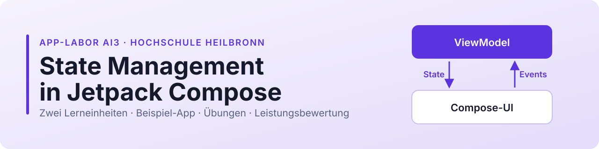

<p align="center"></p>

# State Management in Jetpack Compose

Material zu den zwei Lerneinheiten im App-Labor AI3, Hochschule Heilbronn, WS 2026/27.
Dienstag, 17.11.2026, 14:00–17:15 Uhr, Raum A411.

Team: Douglas Flubacher, Yakob Lahdo, Lennard Schuh

## Bitte vor dem Termin erledigen

Am 17.11. programmiert ihr selbst. Erledigt deshalb diese drei Schritte **zu Hause**, denn beim ersten Start wird viel heruntergeladen:

1. Android Studio und Emulator einrichten: [ANLEITUNG.md](ANLEITUNG.md)
2. Dieses Repo klonen oder als ZIP herunterladen
3. `beispiel-app/` öffnen und einmal starten

Klappt etwas nicht, schaut in die [häufigen Probleme](ANLEITUNG.md#häufige-probleme). Hilft das nicht, meldet euch vor dem Termin bei uns.

## Was liegt wo?

| Pfad | Inhalt | Wann |
|---|---|---|
| [`ANLEITUNG.md`](ANLEITUNG.md) | Android Studio, Emulator, Git, Compose-Grundlagen | vor dem Termin |
| [`beispiel-app/`](beispiel-app/) | App „Einkaufsliste“ mit allen Stufen und Startcode | beide Lerneinheiten |
| [`uebungen/uebung-1.md`](uebungen/uebung-1.md) | Übung 1 | Lerneinheit 1 |
| [`uebungen/uebung-2.md`](uebungen/uebung-2.md) | Übung 2 | Lerneinheit 2 |
| [`leistungsbewertung/aufgabe.md`](leistungsbewertung/aufgabe.md) | Aufgabenstellung der Leistungsbewertung | nach Lerneinheit 2 |
| [`leistungsbewertung/abgabe-vorlage.md`](leistungsbewertung/abgabe-vorlage.md) | Vorlage für eure Abgabe | Leistungsbewertung |
| [`leistungsbewertung/eigenstaendigkeitserklaerung.pdf`](leistungsbewertung/eigenstaendigkeitserklaerung.pdf) | Erklärung zum Ausfüllen und Unterschreiben | Leistungsbewertung |
| [`leistungsbewertung/trainingstagebuch/`](leistungsbewertung/trainingstagebuch/) | App „Trainingstagebuch“ | Leistungsbewertung |

Die Folien findet ihr in ILIAS.

## Leistungsbewertung in Kürze

- Einzelarbeit, ca. 4 Stunden, 100 Punkte. Alle Details stehen in [`aufgabe.md`](leistungsbewertung/aufgabe.md).
- Die Frist steht in ILIAS.
- Abgabe als ZIP-Datei **in ILIAS**, nicht hier. Dazu gehört die unterschriebene Eigenständigkeitserklärung.
- KI-Werkzeuge sind erlaubt, müssen aber angegeben werden.
- Bitte ladet eure Lösung nicht in ein öffentliches Repo hoch.

## Änderungen holen

Korrigieren wir etwas, holt ihr es so:

```bash
git pull
```

Wer schon eigene Änderungen hat, committet sie vorher (siehe [Git-Grundlagen](ANLEITUNG.md#6-git-grundlagen)).
