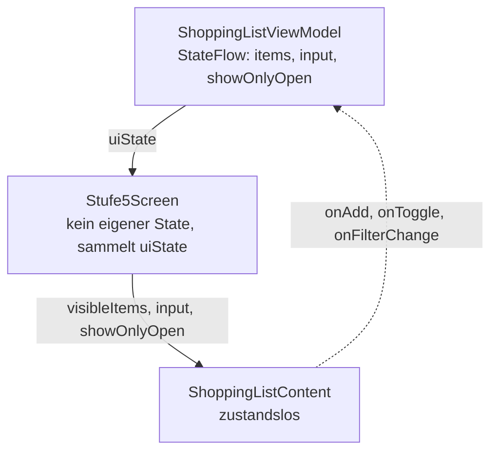

# Leistungsbewertung: Trainingstagebuch

Mobility Project Lab · App-Labor AI3 · Lerneinheiten „State Management in Jetpack Compose“

| | |
|---|---|
| Bearbeitung | einzeln |
| Aufwand | ca. 4 Stunden |
| Abgabe | ZIP-Datei über ILIAS, Frist siehe ILIAS |
| Bewertung | 100 Punkte, Raster siehe unten |

## Worum es geht

Sie bekommen die App **„Trainingstagebuch“**. Sie läuft, sieht ordentlich aus und wirkt auf den ersten Blick fertig. Im Code stecken aber **mindestens fünf Fehler im Umgang mit State**. Die genaue Anzahl verraten wir nicht.

Ihre Aufgabe hat vier Schritte: **finden, beheben, begründen, zeichnen.** Dazu kommt ein kurzer Prüfauftrag, der nur in der App steht.

## Die App

Ein Trainingstagebuch für das heutige Training im Gym.

- **Liste:** Übungen mit Sätzen × Wiederholungen · Gewicht. Abhaken (Checkbox), Löschen (Mülleimer), Antippen klappt Details auf.
- **Gesamtvolumen:** Kopfbereich zeigt das Volumen aller erledigten Übungen (Sätze × Wiederholungen × Gewicht) und den Fortschritt.
- **Filter:** „Nur offene“ sowie Filter nach Muskelgruppe (Mehrfachauswahl, keine Auswahl = alle).
- **Neue Übung:** Button „Übung“ öffnet einen Dialog.
- **Detail-/Bearbeitungsansicht:** über „Bearbeiten“ in einer aufgeklappten Karte. Werte ändern und speichern, mit „Vorherige“/„Nächste“ durch die Übungen blättern, Übung löschen.
- **Menü (⋮):** „Neue Trainingseinheit“ setzt alle Haken zurück.

Erwartetes Verhalten, an dem Sie sich orientieren können: Die App soll sich so verhalten, wie man es von einer gepflegten App aus dem Play Store erwartet. Eingaben gehen nicht verloren, Anzeigen stimmen mit den Daten überein, Aktionen wirken sofort.

## Vorbereitung

1. GitHub-Repo klonen oder als ZIP herunterladen (Einrichtung: `ANLEITUNG.md` im Repo). Ordner `leistungsbewertung/trainingstagebuch/` in Android Studio öffnen (*File → Open*), nicht das ganze Repo.
2. Gradle-Sync abwarten, App auf Emulator oder Gerät starten (minSdk 26).
3. **Automatisches Drehen aktivieren.** Im Emulator drehen Sie mit den Rotations-Buttons in der Seitenleiste oder mit Strg/Cmd + Pfeiltaste.
4. **App freischalten.** Tippen Sie unten in der App auf den Balken und geben Sie Nachname, Matrikelnummer und den Freischaltcode ein. Den Freischaltcode stellen wir nach Lerneinheit 2 in ILIAS. Danach zeigt der Balken Ihren persönlichen **Beleg-Code** (`Nachname · TT-XXXXXX`). Er bleibt gespeichert, auch nach dem Drehen und nach einem Neustart der App, und Sie brauchen ihn auf jedem Screenshot.

Der Balken und das Package `submission` gehören nicht zur Aufgabe und enthalten keine Fehler. Ändern Sie dort nichts.

## Aufgaben

### 1. Fehler finden und reproduzieren

Benutzen Sie die App gründlich, bevor Sie in den Code schauen. Probieren Sie systematisch typische Situationen durch, zum Beispiel:

- Konfigurationsänderungen (Drehen) in jeder Ansicht und mit offenem Dialog
- Listenoperationen (Hinzufügen, Abhaken, Löschen) an verschiedenen Positionen und in Kombination
- Filter in Kombination mit anderen Aktionen
- Wechsel zwischen Ansichten und Blättern in der Detailansicht

Halten Sie für jeden Fehler fest:

- **Reproduktion:** genaue Klickfolge am Gerät/Emulator (inkl. Drehen), so dass jemand anderes den Fehler nachstellen kann.
- **Belegscreenshots:** mindestens zwei Screenshots vom Emulator oder Gerät, einer mit dem fehlerhaften Verhalten und einer mit demselben Ablauf nach Ihrem Fix. Auf jedem Screenshot muss der Balken mit **Ihrem Beleg-Code** zu sehen sein. Nehmen Sie deshalb den ganzen Bildschirm auf, ohne Zuschneiden, und schließen Sie vorher die Bildschirmtastatur, falls sie den Balken verdeckt. Machen Sie die Screenshots vom fehlerhaften Verhalten, bevor Sie den Fehler beheben. Die Screenshots belegen, dass Sie den Fehler selbst am Gerät gefunden haben. Ohne solche Screenshots gibt es für die Reproduktion keine Punkte.
- **Beobachtet vs. erwartet:** Was passiert? Was müsste passieren? Nennen Sie konkrete Werte aus Ihrem eigenen Durchlauf, passend zu Ihren Screenshots.
- **Ort im Code:** Datei und Zeile(n).

### 2. Fehler beheben

- Beheben Sie jeden gefundenen Fehler mit einer **möglichst kleinen, gezielten Änderung**. Keine Umbauten der ganzen App.
- Ändern Sie nur Code, der zu einem dokumentierten Fehler gehört.
- Geben Sie jeden Fix als **Diff** an (z. B. `git diff`, oder Vorher/Nachher-Ausschnitt im Format `- alte Zeile` / `+ neue Zeile`).
- Prüfen Sie nach jedem Fix am Gerät, dass der Fehler weg ist und nichts anderes kaputtgegangen ist.

Tipp: Wenn Sie das Repo geklont haben, liefert `git diff` die Diffs fast von selbst. Wer das ZIP heruntergeladen hat, legt vor dem ersten Fix ein lokales Git-Repository an (`git init`, erster Commit). Laden Sie Ihre Lösung nicht in ein öffentliches Repo hoch.

### 3. Begründen

Erklären Sie pro Fehler in 3–6 Sätzen, **warum** der Fehler auftritt und **warum** Ihr Fix ihn behebt. Verwenden Sie die Fachbegriffe aus den Lerneinheiten, z. B. Recomposition, beobachtbarer State, `remember` vs. `rememberSaveable`, Konfigurationsänderung, State Hoisting, Single Source of Truth, abgeleiteter State, Unidirectional Data Flow, ViewModel-Lebensdauer. Die Begründung muss sich auf das **beobachtete Verhalten dieser App** beziehen, nicht nur allgemein sein.

### 4. Zustandsdiagramm „Wem gehört welcher State?“

Zeichnen Sie für diese App zwei Diagramme:

- **Vorher:** Welche State-Werte gibt es, wo liegen sie (ViewModel, welches Composable, `remember`/`rememberSaveable`, gar nicht beobachtbar), wie fließen Daten nach unten und Events nach oben? Markieren Sie die Stellen, an denen die Fehler entstehen.
- **Nachher:** derselbe Ausschnitt nach Ihren Fixes.

Gemeint ist **kein UML-Zustandsautomat** mit Zuständen und Übergängen, sondern eine Skizze, wem welcher State gehört und wie Daten und Events fließen. So sieht das für eine andere App aus, die Einkaufsliste aus den Lerneinheiten (Stufe 5), stark verkürzt:



Für das Trainingstagebuch gehören mehr Composables und State-Werte dazu, und im Vorher-Diagramm markieren Sie die Fehlerstellen.

Form: Mermaid (in `abgabe.md`) oder saubere Handskizze/Zeichnung als Bild (PNG/JPG/PDF) im ZIP. Beides ist gleichwertig.

## Prüfauftrag aus der App

Ein Teil der Aufgabe steht nur in der App. Nach dem Freischalten (siehe Vorbereitung) zeigt sie ihn, wenn Sie auf den Balken tippen. Der Prüfauftrag besteht aus kurzen Abläufen mit persönlichen Werten, die Sie in Ihrer korrigierten App durchführen. Tragen Sie die Ergebnisse in `abgabe.md` im Abschnitt „Prüfauftrag aus der App“ ein und legen Sie die verlangten Screenshots bei, ebenfalls mit sichtbarem Beleg-Code.

## Nutzung von KI

KI-Werkzeuge (ChatGPT, Copilot, Gemini in Android Studio, Claude …) **dürfen** Sie verwenden. Sie müssen aber in `abgabe.md` angeben:

- welches Werkzeug,
- **wofür** (z. B. „Erklärung einer Compose-Funktion“, „Vorschlag für Fix 3“),
- **was Sie übernommen haben** und was Sie verworfen oder geändert haben.

Bewertet wird, was Sie selbst geprüft und begründet haben. Reproduktionsschritte und Prüfauftrag müssen Sie selbst am Gerät/Emulator durchgeführt und mit Screenshots belegt haben.

Fehlende oder falsche Angaben zur KI-Nutzung führen zu Abzug (siehe Raster).

## Abgabe

Eine ZIP-Datei `Nachname_Vorname_Trainingstagebuch.zip` mit:

```
Nachname_Vorname_Trainingstagebuch.zip
├── abgabe.md                 ← ausgefüllte Vorlage (abgabe-vorlage.md)
├── eigenstaendigkeitserklaerung.pdf  ← ausgefüllt und unterschrieben (Scan oder Foto geht auch)
├── screenshots/              ← Belegscreenshots, z. B. fehler1_fehlerhaft.png, fehler1_behoben.png, pruefauftrag1.png
├── diagramme/                ← nur falls Sie Bilder statt Mermaid verwenden
└── trainingstagebuch/        ← das korrigierte Projekt
```

- Ohne ausgefüllte und unterschriebene Eigenständigkeitserklärung ist die Abgabe nicht vollständig. Die Vorlage liegt neben dieser Aufgabe.
- Das Projekt muss sich in Android Studio öffnen, bauen und starten lassen.
- Bitte **ohne** die Ordner `build/`, `app/build/`, `.gradle/`, `.idea/` und ohne `local.properties` packen.
- Verwenden Sie die Vorlage `abgabe-vorlage.md` und benennen Sie sie in `abgabe.md` um.

## Bewertung (Überblick)

| Teil | Punkte |
|---|---|
| Fehler: Reproduktion mit Screenshots, Fix, Begründung (5 Fehler à 12 P) | 60 |
| Zustandsdiagramm vorher/nachher | 20 |
| Qualität: App läuft, Prüfauftrag aus der App, Fixes minimal und sauber, Abgabe vollständig, KI-Angabe | 20 |
| **Summe** | **100** |
| Bonus: weiterer Fehler über fünf hinaus, vollständig dokumentiert | bis +6 |

Die Gesamtpunktzahl ist auf 100 begrenzt.

Viel Erfolg!
